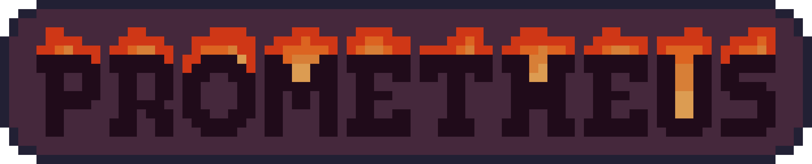

  <h2>
    Grand engines, like great fires, begin with the smallest spark.
  </h2>
  
  

## About
**Prometheus** is a rendering library that uses Raylib as its backend, some differences are included Texture Managers and some abstraction, styling is also changed to better fit some projects, check [CONTRIBUTING.md](CONTRIBUTING.md) for more information.

---
Copyright © 2026 Elias Andersson. All rights reserved.
